# ROS 2 工作空间、节点与话题通信

## 前言

我平时写 C++，习惯把所有逻辑塞进一个 `main` 里，函数多了就靠注释分区。这种方式在小作业里没问题，但一旦要"一边读数据、一边算、一边输出"，就得自己想办法让几件事同时进行，还要自己解决它们之间怎么传数据。

ROS 2 把系统拆成一个个**节点**：每件事单独一个进程，节点之间用**话题**传数据。这样最直接的好处是每个节点可以单独启动、单独看日志、单独改，出问题能定位到具体哪一个；传数据这件事也不用自己造轮子，换个话题名就换了数据通道。

我最困惑的一点是：**发布者根本不知道谁在听，那这条消息到底发给谁了？** 如果没人听，它会不会报错、会不会堵住？

我打算这样验证：先只开 `listener`，看它会不会报错；再开 `talker`，看两边能不能对上；最后用 `ros2 topic echo` 再插一个"只听不打印"的订阅者，看同一条消息能不能被两个订阅者同时收到。

我的实践环境：

| 项目 | 内容 |
| --- | --- |
| 操作系统 / 版本 | Ubuntu 22.04.5 LTS（内核 6.8.0-138-generic），VirtualBox 虚拟机 |
| ROS 版本 | ROS 2 **Humble**（`/opt/ros/humble`） |
| 编译器 / 构建 | g++ 11.4.0、CMake 3.22.1、`colcon` |
| 编辑器 | VS Code（`code .` 打开包目录） |
| 工作空间 / 功能包 | `~/projects/HelloCV/ros2_ws`，包名 `ros2_lab` |

**包里有什么**

| 文件 | 作用 |
| --- | --- |
| `src/talker.cpp` | 发布者节点：每秒往 `chatter` 发一条 `hello N` |
| `src/listener.cpp` | 订阅者节点：订阅 `chatter` 并打印 |

## 一、环境与准备

### 1. 环境检查

```bash
printenv ROS_DISTRO
which ros2
ls /opt/ros
```

真实输出：

```
humble
/opt/ros/humble/bin/ros2
humble
```

说明：当前终端**已经** source 过 ROS 环境（`.bashrc` 里有一行 `source /opt/ros/humble/setup.bash`），所以 `ros2` 命令能直接用、`ROS_DISTRO` 有值。

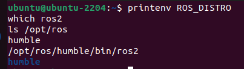

**我的理解**

`source` 的作用是把 `/opt/ros/humble` 里定义的环境变量（`PATH`、`AMENT_PREFIX_PATH`、`CMAKE_PREFIX_PATH` 等）导入**当前这个终端**。没有它，连 `ros2` 这个命令都找不到。

所以新终端报 `ros2: command not found` 时，先查两件事：`.bashrc` 里那行 `source /opt/ros/humble/setup.bash` 还在不在；`ls /opt/ros` 看装的发行版名字对不对。

### 2. 创建工作空间与功能包

```bash
mkdir -p ~/projects/HelloCV/ros2_ws/src
cd ~/projects/HelloCV/ros2_ws/src
ros2 pkg create ros2_lab --build-type ament_cmake --license Apache-2.0 \
  --dependencies rclcpp std_msgs
```

真实输出：

```
going to create a new package
package name: ros2_lab
destination directory: /home/ubuntu/projects/HelloCV/ros2_ws/src
package format: 3
version: 0.0.0
description: TODO: Package description
maintainer: ['ubuntu <clg506921@gmail.com>']
licenses: ['Apache-2.0']
build type: ament_cmake
dependencies: ['rclcpp', 'std_msgs']
creating folder ./ros2_lab
creating ./ros2_lab/package.xml
creating source and include folder
creating folder ./ros2_lab/src
creating folder ./ros2_lab/include/ros2_lab
creating ./ros2_lab/CMakeLists.txt
```

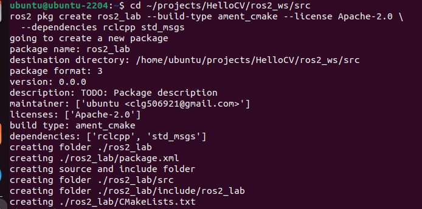

注意命令行里的**顺序**：包名 `ros2_lab` 写在 `--dependencies` 前面。`--dependencies` 是"吃多个值"的选项，如果包名写在它后面，会被当成依赖名收走，结果报 `error: the following arguments are required: package_name`。

建完的目录（`ls -R ros2_lab` 真实输出）：

```
ros2_lab:
CMakeLists.txt  include  LICENSE  package.xml  src

ros2_lab/include:
ros2_lab

ros2_lab/include/ros2_lab:

ros2_lab/src:
```

`src/` 和 `include/ros2_lab/` 都是空的——脚手架只建目录，代码要自己写。

### 3. `package.xml` 与 `CMakeLists.txt` 各管什么

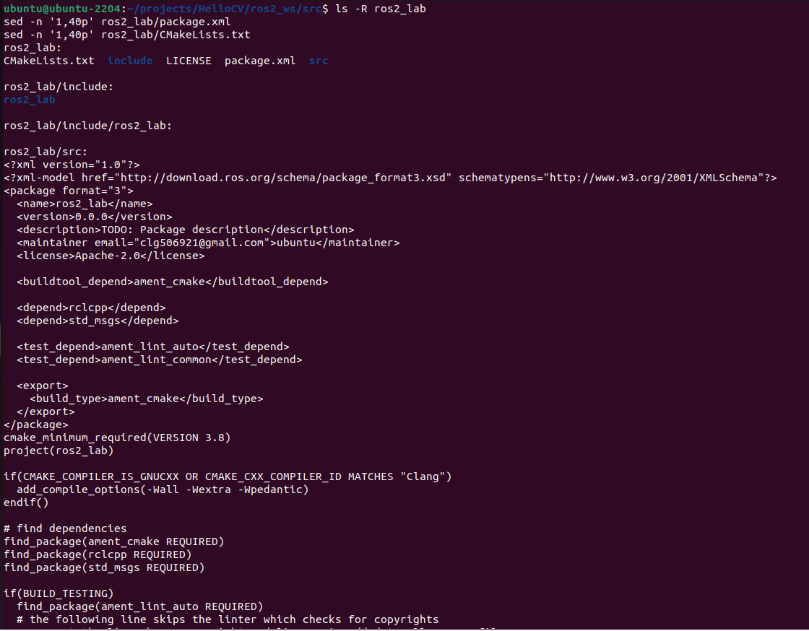

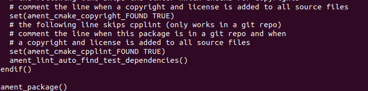

| 文件 | 管什么 | 我这份里的关键行 |
| --- | --- | --- |
| `package.xml` | 包的"身份证 + 依赖清单"：包名、版本、维护者、许可、依赖哪些包 | `<name>ros2_lab</name>`、`<depend>rclcpp</depend>`、`<depend>std_msgs</depend>` |
| `CMakeLists.txt` | 构建说明：用哪些包、编译哪些源文件、生成什么、装到哪 | `find_package(rclcpp REQUIRED)`、`ament_package()`（此时**还没有** `add_executable`） |

刚创建时 `CMakeLists.txt` 里**没有** `add_executable(...)`，意味着：这个包能编译，但**不会生成任何可执行文件**，所以那时 `ros2 run ros2_lab talker` 是找不到东西可跑的。

**我的理解**

我一开始觉得这是重复劳动：同一个依赖为什么要写两遍？后来发现两边管的事不一样——

- `package.xml` 是给 **ROS 生态**看的清单：`colcon` 靠它排构建顺序，`rosdep` 靠它装依赖；
- `CMakeLists.txt` 里的 `find_package` 是给 **CMake / 编译器**看的：只有它会把头文件路径加进编译命令。

只改前者的后果是配置阶段就报找不到包；只改后者的后果是这台机器能编过，换台机器或别人 clone 下来就可能缺东西。

## 二、学习内容整理

### 1. 核心概念（用自己的话）

- **节点（Node）**：一个能独立启动、独立运行的程序单元；
- **话题（Topic）**：节点之间传数据的一条"管道"，发布者往里写、订阅者从里面读，两边互不知道对方是谁；
- **消息（Message）**：管道里传的数据格式，例如 `std_msgs/msg/String` 只有一个 `data` 字段；
- **QoS**：这条管道的服务质量约定（保留多少条、要不要保证送达），两端要对得上；
- **包 / 可执行文件**：包是能独立编译安装的单位，可执行文件是包里真正被 `ros2 run` 启动的东西。

我原来的理解：节点之间像函数调用——"我调你一下，你给我结果"，调用方知道被调方是谁。

实际的理解：节点之间是**通过话题间接通信**的。发布者只管往 `/chatter` 里写，订阅者只管从 `/chatter` 里读，谁也不知道对方存在；两边能通，靠的是**话题名对上了**，不是靠谁认识谁。

让我改想法的那一步：只开 `listener` 时它一条都不打印，也不报错；再开 `talker`，它立刻开始收。也就是说"没人发"和"没人收"都不会报错——通信是松耦合的。好处是可以随时再加一个 `topic echo` 而不影响双方，坏处是出问题时没人会提醒你"这两头没接上"。

### 2. 常用命令（目前真用过的）

| 命令 | 作用 | 我用它做了什么 |
| --- | --- | --- |
| `printenv ROS_DISTRO` | 看当前 shell 的 ROS 发行版 | 输出 `humble` |
| `which ros2` | 看 `ros2` 命令来自哪里 | `/opt/ros/humble/bin/ros2` |
| `ros2 pkg create` | 创建功能包 | 生成 `ros2_lab` 的骨架 |
| `colcon build --packages-select ros2_lab` | 只编译这个包 | 7.25 秒编译完成 |
| `source install/setup.bash` | 让当前终端认识刚编出来的包 | 之后 `ros2 run` 才找得到 |
| `ros2 run ros2_lab talker` | 运行包里的可执行文件 | 每秒打印一条 `hello N` |

后面几步还会用到 `ros2 node list` / `ros2 topic list` / `ros2 topic echo`，等订阅者写完一起验证。

### 3. 发布者节点是怎么写出来的

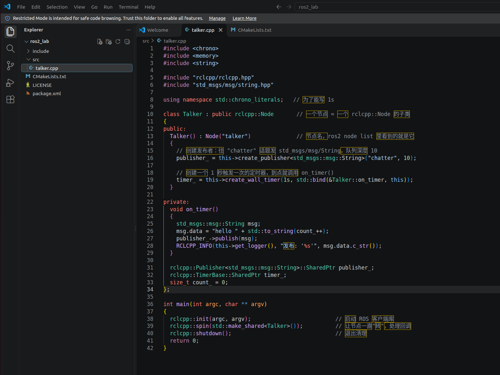

核心三段：

```cpp
// 1) 创建发布者：往 "chatter" 话题发 std_msgs/msg/String，队列深度 10
publisher_ = this->create_publisher<std_msgs::msg::String>("chatter", 10);

// 2) 1 秒触发一次的定时器，到点调用 on_timer()
timer_ = this->create_wall_timer(1s, std::bind(&Talker::on_timer, this));

// 3) 定时器回调：组一条消息发出去
std_msgs::msg::String msg;
msg.data = "hello " + std::to_string(count_++);
publisher_->publish(msg);
```

`main` 里只有三行，但它们决定了程序怎么活：

```cpp
rclcpp::init(argc, argv);                     // 启动 ROS 客户端库
rclcpp::spin(std::make_shared<Talker>());     // 让节点一直转，处理回调
rclcpp::shutdown();                           // 退出清理
```

**我的理解**

没有 `rclcpp::spin`，定时器**不会触发**：`create_wall_timer` 只是登记了一个"到点要调用的函数"，真正去执行它的是 `spin` 里的执行器。少了 spin，程序会走完 `main` 直接退出。

`1s` 这个周期是传给 `create_wall_timer` 的实参，和消息内容无关；它只在**构造定时器时**生效——学到参数那一节会看到，运行中改 `publish_rate` 并不会改变已经建好的定时器。

### 4. 订阅者节点是怎么写出来的

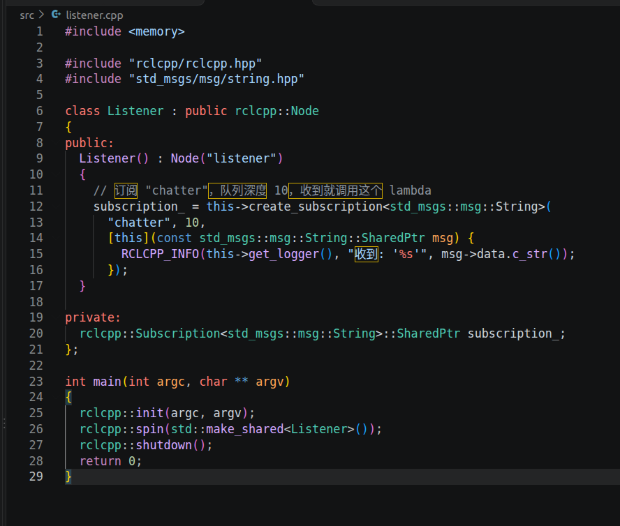

发布者和订阅者的结构几乎对称，区别只在这两处：

```cpp
// 发布者：创建"往话题里写"的对象 + 一个定时器
publisher_ = this->create_publisher<std_msgs::msg::String>("chatter", 10);
timer_ = this->create_wall_timer(1s, std::bind(&Talker::on_timer, this));

// 订阅者：创建"从话题里读"的对象 + 一个回调（收到就执行）
subscription_ = this->create_subscription<std_msgs::msg::String>(
  "chatter", 10,
  [this](const std_msgs::msg::String::SharedPtr msg) {
    RCLCPP_INFO(this->get_logger(), "收到: '%s'", msg->data.c_str());
  });
```

两处 `"chatter"` 就是同一个话题名——发布者往这个名字写、订阅者从这个名字读，**名字对上才通得了**。

新增可执行文件时，`CMakeLists.txt` 要同时改两处，漏第二处就会出现 `No executable found`：

```cmake
add_executable(listener src/listener.cpp)
ament_target_dependencies(listener rclcpp std_msgs)

install(TARGETS talker listener
  DESTINATION lib/${PROJECT_NAME})
```

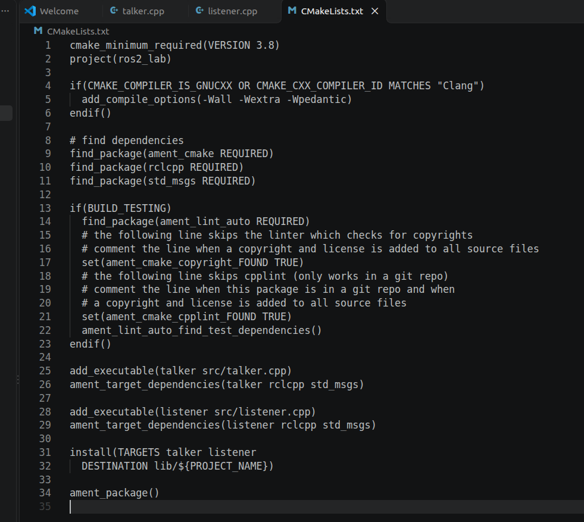

**我的理解**

是同一个东西：都表示队列深度（等价于 `KeepLast(10)`），只是分别管"发送端最多缓存多少条"和"接收端最多缓存多少条"。两端深度不必相同，但 QoS 的**可靠性策略**必须兼容，否则一条都收不到（3.4 节的实验验证了这一点）。

丢消息时我的检查顺序：先 `ros2 topic info /chatter -v` 看两端 QoS 是否兼容；再看两端深度是不是太小；最后才怀疑代码。

## 三、实践过程

### 1. 编译

**第一次编译**（只有 `talker`）：

```bash
cd ~/projects/HelloCV/ros2_ws
colcon build --packages-select ros2_lab
```

```
Starting >>> ros2_lab
Finished <<< ros2_lab [7.25s]

Summary: 1 package finished [7.97s]
```

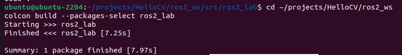

**第二次编译**（加上了 `listener`）：

```bash
colcon build --packages-select ros2_lab
source install/setup.bash
```

```
Starting >>> ros2_lab
Finished <<< ros2_lab [8.78s]

Summary: 1 package finished [8.99s]
```

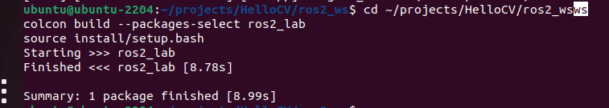

时间从 7.25 s 变成 8.78 s，因为多编了一个源文件。注意这两条命令**顺序不能换**：先 `build` 让产物落到 `install/`，再 `source install/setup.bash` 让当前终端认识它。

编译后在 `ros2_ws` 下多了三个目录：`build/`（中间产物）、`install/`（可安装的产物）、`log/`（构建日志）。**这三个都不该提交到仓库**，所以我在仓库根的 `.gitignore` 里加了 `build/`、`install/`、`log/`。

**我的理解**

`build/` 放的是**中间产物**：CMake 缓存、`.o` 文件、生成的 Makefile；`install/` 放的是**可用的成品**：编好的可执行文件（`install/ros2_lab/lib/ros2_lab/`）、`launch/`，还有包的元信息。

`ros2 run` 之前要先 `source install/setup.bash`，是因为它靠环境变量里的路径去找包——source 之前，这个终端根本不知道 `install/` 在哪。

### 2. 运行

```bash
source install/setup.bash
ros2 run ros2_lab talker
```

真实输出（每秒一条，数字一直递增）：

```
[INFO] [1792563631.451483615] [talker]: 发布: 'hello 0'
[INFO] [1792563632.644476636] [talker]: 发布: 'hello 1'
[INFO] [1792563633.468973827] [talker]: 发布: 'hello 2'
[INFO] [1792563634.526447055] [talker]: 发布: 'hello 3'
[INFO] [1792563635.480421545] [talker]: 发布: 'hello 4'
[INFO] [1792563636.433767180] [talker]: 发布: 'hello 5'
[INFO] [1792563637.470116849] [talker]: 发布: 'hello 6'
[INFO] [1792563638.458475568] [talker]: 发布: 'hello 7'
```

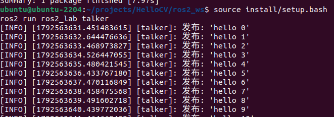

跑了大约两分钟，数到 `hello 127` 时我按了 `Ctrl+C`，终端最后是这个样子：

```
[INFO] [1792563758.396814421] [talker]: 发布: 'hello 127'
[INFO] [1792563759.104461273] [rclcpp]: signal_handler(SIGINT/SIGTERM)
^Cubuntu@ubuntu-2204:~/projects/HelloCV/ros2_ws$
```

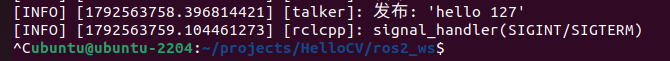

`signal_handler(SIGINT/SIGTERM)` 是 `rclcpp` 收到 `Ctrl+C`（SIGINT）后做的收尾：它会停止 spin、让 `rclcpp::shutdown()` 走完，所以进程是**正常退出**，不是崩溃。退回到提示符就说明节点已经没了。

**我的理解**

按 `Ctrl+C` 时信号被 `rclcpp` 捕获（日志里那行 `signal_handler(SIGINT/SIGTERM)` 就是它），程序走完 `rclcpp::shutdown()` 正常退出。进程没了，它在 ROS 图上注册的节点也就消失了，所以 `ros2 node list` 里看不到它——不是被隐藏，而是**真的下线了**。

如果希望退出后还留下点东西，得在退出前自己写日志，或者用 `ros2 bag record` 把话题录下来。

### 3. 起两个节点，用命令行观察

两个终端都先 `cd ~/projects/HelloCV/ros2_ws && source install/setup.bash`，然后分别启动：

```bash
# 终端 A
ros2 run ros2_lab listener

# 终端 B
ros2 run ros2_lab talker
```

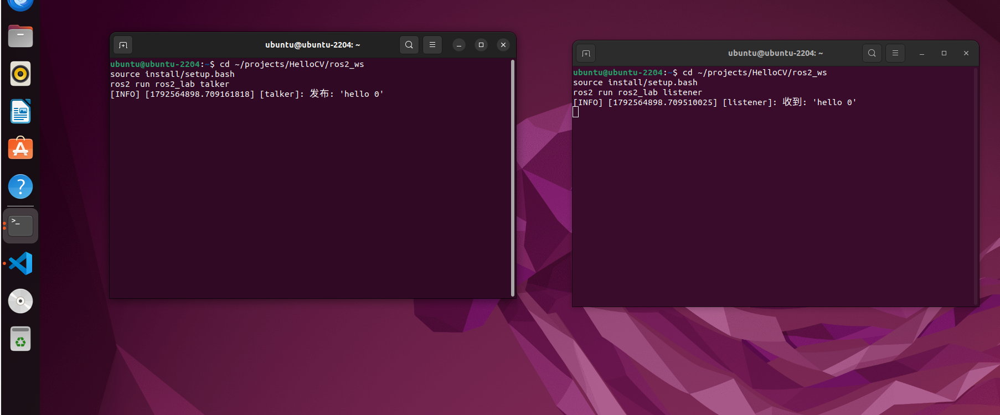

第一个 `hello 0` 在两边的时间戳几乎相同（`…898.709` 与 `…898.7095`），说明消息是"发出去马上就被收到"的。跑了 40 多条以后，两边的编号始终一一对应：

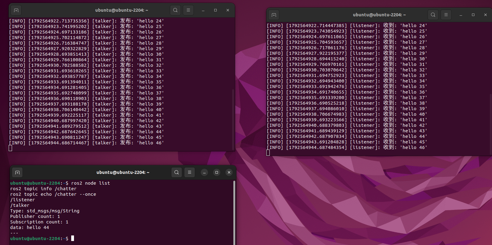

再开第三个终端（同样先 `cd` + `source`）观察这个系统：

```bash
ros2 node list
ros2 topic info /chatter
ros2 topic echo /chatter --once
```

真实输出：

```
/listener
/talker
```

```
Type: std_msgs/msg/String
Publisher count: 1
Subscription count: 1
```

```
data: hello 44
---
```

三个现象连起来看：`node list` 说明两个节点都活着；`topic info` 说明 `/chatter` 上确实挂着 1 个发布者、1 个订阅者；`topic echo` 能收到内容，说明**它自己也是一个订阅者**——命令行工具并不是"旁观者"，它加入话题的方式和我的 listener 一样。

**我的理解**

`ros2 topic echo` 能收到内容，说明它自己也创建了一个订阅者——命令行工具不是"旁观的调试器"，它是**真的加入了这条话题**。

所以"能收到"不代表只有我的 `listener` 能收到；同一条消息可以被任意多个订阅者同时收到，这正是发布/订阅模型和队列、邮件的区别。

### 4. QoS 小实验：两端对不上会怎样

我原来以为 `10` 只是个"队列长度"，做完这个实验才知道它是 QoS 的一部分。把 `talker` 的发布者改成"尽力而为"，`listener` 保持默认的"可靠"：

```cpp
// talker.cpp：改之前
publisher_ = this->create_publisher<std_msgs::msg::String>("chatter", 10);

// 改之后：显式声明 BEST_EFFORT
auto qos = rclcpp::QoS(10).best_effort();
publisher_ = this->create_publisher<std_msgs::msg::String>("chatter", qos);
```

重新编译后两个终端各跑一个。结果是 **listener 一条都收不到**，但两边都打印了警告（真实输出）：

```
[WARN] [1792565353.665883165] [listener]: New publisher discovered on topic '/chatter', offering incompatible QoS. No messages will be sent to it. Last incompatible policy: RELIABILITY_QOS_POLICY
```

```
[INFO] [1792565353.653513498] [talker]: New subscription discovered on topic '/chatter', requesting incompatible QoS. No messages will be sent to it. Last incompatible policy: RELIABILITY_QOS_POLICY
```

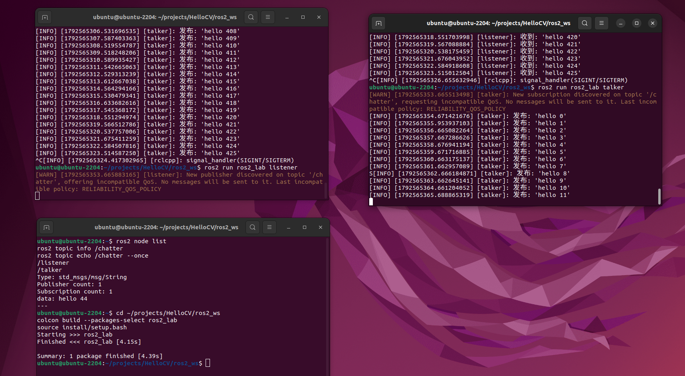

用 `ros2 topic info /chatter -v` 能看到两端的差异（节选）：

```
Publisher count: 1
  Node name: talker
  QoS profile:
    Reliability: BEST_EFFORT
    Durability: VOLATILE
    ...
Subscription count: 1
  Node name: listener
  QoS profile:
    Reliability: RELIABLE
    Durability: VOLATILE
    ...
```

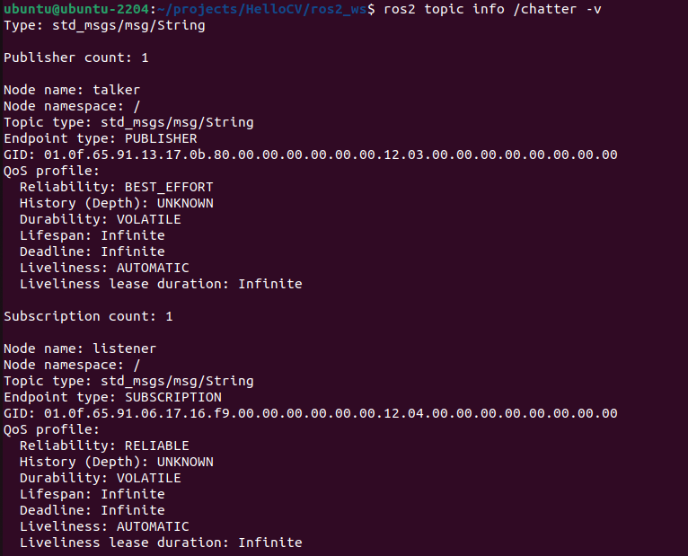

把 `talker.cpp` 改回 `10`（等价于 `KeepLast(10)` + `RELIABLE`）重新编译，就又能收到了。

**结论**：两端"要求的方向"对不上——订阅端要求**可靠**、发布端只保证**尽力而为**——数据就不会被投递。但**不是悄悄失败**：rclcpp 会打印提示，并明确写出是 `RELIABILITY_QOS_POLICY` 这个策略不兼容。

**我的理解**

因为 QoS 不是"数据本身"，而是**发现阶段就互相告知的元数据**：两个端点一发现对方，就会交换各自的 QoS 描述（可靠性、历史深度、持久性）。发布者拿到的"订阅者描述"里带着"我要求 RELIABLE"，而它自己只能提供 BEST_EFFORT，对不上就直接判定不投递，并打一条 WARN 说明是哪个策略不兼容。

哪一端让步都能恢复：把订阅端改成 `best_effort`，或者把发布端改回 `reliable`。我选的是后者，因为我的数据不丢更重要。

## 四、问题与排查记录

### 1. `source` 的目录不对，连带 `ros2 run` 报 Package not found

**现象**：在家目录下直接 `source install/setup.bash`，两条命令连着报错：

```
ubuntu@ubuntu-2204:~$ source install/setup.bash
bash: install/setup.bash: No such file or directory
ubuntu@ubuntu-2204:~$ ros2 run ros2_lab listener
Package 'ros2_lab' not found
```

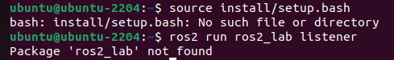

**原因**：两个错误其实是同一个根因。看提示符 `ubuntu@ubuntu-2204:~$`，`~` 表示当前在**家目录**，而 `install/` 在 `~/projects/HelloCV/ros2_ws/` 下面。`source` 用的是相对路径，找不到文件就失败；`source` 没成功，`ros2_lab` 就没有进入这个终端的环境，所以 `ros2 run` 认为"没有这个包"。

**修改**：先回到工作空间再 source（或者直接用绝对路径，不依赖当前目录）：

```bash
cd ~/projects/HelloCV/ros2_ws
source install/setup.bash

# 等价写法
source ~/projects/HelloCV/ros2_ws/install/setup.bash
```

**验证**：`ros2 run ros2_lab listener` 正常启动。

**理解**：

- `source` 只影响**当前终端**，新开一个终端就要再 source 一次；
- 看到 `Package not found` 时，先查三件事：`pwd` 是否在 `ros2_ws`、`source` 是否真的成功、`echo $AMENT_PREFIX_PATH` 里有没有这个包的路径——**不要一上来就怀疑代码或编译**；
- 这个错我一共犯了三次（第一次 source 找不到文件、第二次在新终端跑 client、第三次跑带 `--ros-args` 的 talker），说明"知道"不等于"做到"。最后我在 `~/.bashrc` 里加了一行 `source ~/projects/HelloCV/ros2_ws/install/setup.bash`，让每个新终端自动认识这个包，比每次提醒自己可靠。

### 2. 受控实验：删掉 `install(TARGETS ...)` 会怎样

这个实验是故意制造错误，用来确认"编译成功"和"能被 `ros2 run` 找到"是两件事。

**做法**：把 `CMakeLists.txt` 里的

```cmake
install(TARGETS talker
  DESTINATION lib/${PROJECT_NAME})
```

临时注释掉，重新 `colcon build`，再 `ros2 run ros2_lab talker`。

**预期**：编译仍然成功，但 `ros2 run` 会报错，因为包里确实找不到这个可执行文件——包存在、目标存在，只是没被"安装"到 `install/` 下面。

结果：编译**成功**，但 `ros2 run` 找不到东西：

```
Starting >>> ros2_lab
Finished <<< ros2_lab [19.5s]

Summary: 1 package finished [20.5s]
No executable found
```

把 `install` 那两行改回来再编译，立刻恢复正常：

```
Finished <<< ros2_lab [2.41s]

Summary: 1 package finished [2.82s]
[INFO] [1792647161.891963401] [talker]: talker 启动: publish_rate=1.00 Hz, message_prefix=hello, max_count=0
[INFO] [1792647162.893428104] [talker]: 发布: 'hello 0'
[INFO] [1792647163.892651935] [talker]: 发布: 'hello 1'
```

**我的理解**

`add_executable` 是"**造出来**"：把源文件编译成一个目标；`install(TARGETS ...)` 是"**摆到能被找到的地方**"：把目标复制到 `install/<包>/lib/<包>/`，并让 `ros2 run` 能找到它。

少了后者，编译照样成功，但 `ros2 run` 报 `No executable found`——我专门做了一次受控实验，就是这个现象。

### 3. 问题汇总表

| # | 现象 | 原因分析 | 解决办法 | 验证结果 |
| --- | --- | --- | --- | --- |
| 1 | `source install/setup.bash` 报 `No such file or directory`，接着 `ros2 run` 报 `Package 'ros2_lab' not found` | 当前目录在 `~`，相对路径找不到 `install/`；source 失败后终端环境里没有这个包 | 先 `cd` 到 `ros2_ws` 再 source（或用绝对路径） | 正常启动 |
| 2 |  |  |  |  |

## 五、测试与验证

| 测试项 | 方法 | 预期结果 | 实际结果 | 结论 |
| --- | --- | --- | --- | --- |
| 环境可用 | `printenv ROS_DISTRO` | 输出 humble | `humble` | 通过 |
| 包创建 | `ros2 pkg create ros2_lab ...` | 生成骨架 | 生成 4 个文件/目录 | 通过 |
| 编译 | `colcon build --packages-select ros2_lab` | 无报错 | `Finished <<< ros2_lab [7.25s]` | 通过 |
| 运行 | `ros2 run ros2_lab talker` | 每秒一条 | `hello 0..127` | 通过 |
| 正常退出 | `Ctrl+C` | 收尾而不是崩溃 | `signal_handler(SIGINT/SIGTERM)` | 通过 |
| 订阅端接收 | 两个终端分别跑 listener / talker | 收端打印同样内容 | `收到: 'hello 0/1/2…'`，编号一一对应 | 通过 |
| 编译失败特征 | 注释掉 `install(TARGETS …)` 重新编译 | 编得过但跑不了 | `No executable found` | 通过（受控实验） |

## 六、回顾与心得

1. **`source` 是给终端用的**，不是给系统的：新终端要重新 source，改完代码要重新 source，忘了它就是 `Package not found`；
2. **包和可执行文件是两个层次**：包是编译安装的单位，`ros2 run` 找的是包里被 `install` 过的目标；
3. **`init → spin → shutdown` 的分工**：`init` 起库，`spin` 是唯一让回调跑起来的地方，`shutdown` 收尾。

- QoS 的其它策略（`durability`、`history`、`deadline`）我只看了名字，没做实验；
- `colcon build --symlink-install` 的好处没验证；
- 参数回调（`add_on_set_parameters_callback`）还没试，所以"频率热改"目前只能靠重启。

## 参考资料

- [R1] ROS 2 Documentation — Humble：概念、教程与命令行工具说明
- [R2] 动手学 ROS 2：中文入门教程
- [T1] rclcpp 的 `Node` / `Publisher` / `Timer` / `spin` API 文档
