# ROS 2 服务、参数、TF 与 launch

## 前言

话题像**广播**：我喊一声"现在有数据了"，谁在听谁听，喊完我就不管了。
服务像**打电话**：我拨号，必须有人接、接了必须回话，我才知道结果。

所以"问一个具体问题、并且要拿到答案"这类需求，用话题很别扭（要么再开一条话题专门传答案，要么自己约定格式），用服务就顺理成章。

我的实践环境：

| 项目 | 内容 |
| --- | --- |
| 操作系统 / 版本 | Ubuntu 22.04.5 LTS（内核 6.8.0-138-generic），VirtualBox 虚拟机 |
| ROS 版本 | ROS 2 **Humble**（`/opt/ros/humble`） |
| 编译器 / 构建 | g++ 11.4.0、CMake 3.22.1、`colcon` |
| 工作空间 / 功能包 | `~/projects/HelloCV/ros2_ws`，包名 `ros2_lab` |

本篇涉及的代码文件：

| 文件 / 目标 | 作用 |
| --- | --- |
| `src/add_two_ints_server.cpp`、`..._client.cpp` | 服务端与客户端，算出 `3 + 4 = 7` |
| `src/talker.cpp`（改造） | 加了 `publish_rate` / `message_prefix` / `max_count` 三个参数 |
| `src/tf_broadcaster.cpp` | 广播 `base_link → laser` |
| `launch/demo.launch.py` | 一条命令起 talker / listener / tf_broadcaster |

## 一、服务（Service）

### 1. 先加依赖：`example_interfaces`

`AddTwoInts` 这个服务类型不在 `rclcpp` 里，而在 `example_interfaces` 包里。所以要在**两个**文件里都加上：

**`package.xml`**（第 14 行）：

```xml
<depend>example_interfaces</depend>
```

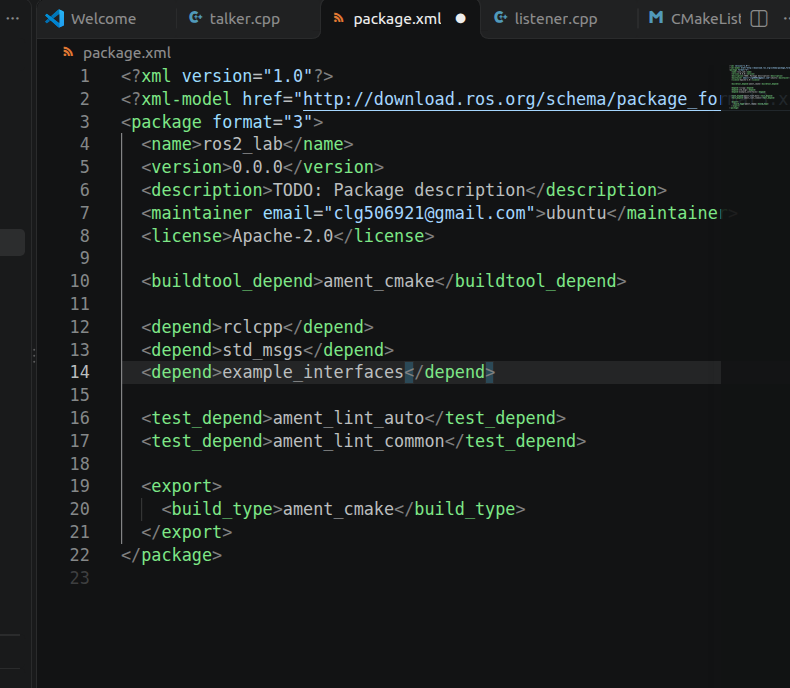

**`CMakeLists.txt`**（第 12 行，放在其他 `find_package` 后面）：

```cmake
find_package(example_interfaces REQUIRED)
```

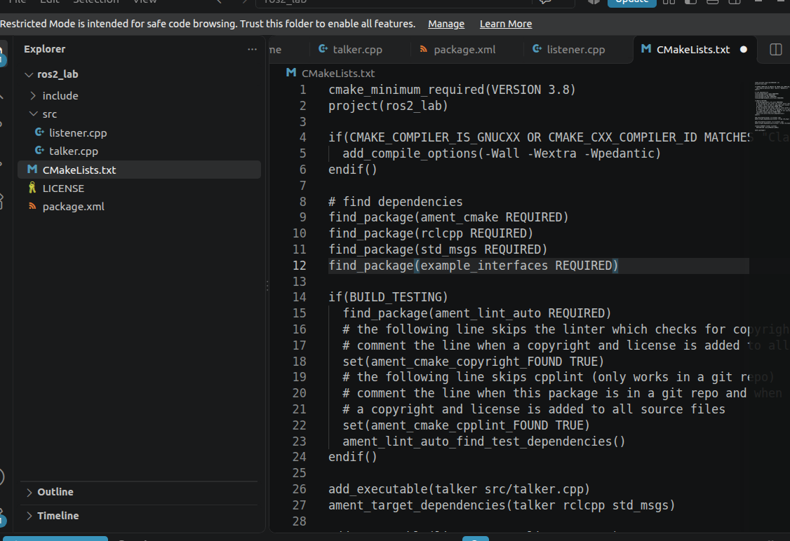

两个文件各管一半：`package.xml` 是给 ROS 生态看的依赖清单（决定编译顺序、要不要装东西），`CMakeLists.txt` 里的 `find_package` 才是真正让编译器找到头文件的那一步。

**我的理解**

依赖这件事看起来只是"多写两行"，其实是两个文件各管一半，而且规则完全不同：

- **`package.xml` 是"清单"**：条目顺序无所谓，但每条必须写在清单区里，习惯顺序是 `buildtool_depend` → 一堆 `depend` → `test_depend` → `export`。不能把 `<depend>` 塞进 `<export>` 里，也不能写到 `</package>` 之后；`<depend>` 一行同时代表"编译依赖 + 运行依赖"，不用再拆成两行。
- **`CMakeLists.txt` 是"流水线"**：顺序就是执行顺序，有三条铁律——
  1. `find_package(X)` 必须在**使用 X 的命令**之前。因为 `find_package` 才把 X 的头文件路径和目标定义出来，写在 `ament_target_dependencies(... X ...)` 之后就会在配置阶段报找不到这个包；
  2. `add_executable` 必须在 `install(TARGETS ...)` 之前（我踩过：`CMake Error … install TARGETS given target … which does not exist`）；
  3. `ament_package()` 永远在最后一行。

只改一个会怎样：

| 只改 `package.xml`、漏 `find_package` | 只改 `CMakeLists.txt`、漏 `package.xml` |
| --- | --- |
| 配置阶段 `ament_target_dependencies` 就找不到这个包，构建当场停；即使绕过去，编译时也会因为找不到头文件而失败 | 本机可能编得过，但依赖清单里没有它：`colcon` 不知道构建顺序、`rosdep` 不会帮你装、别人 clone 下来就可能缺包 |

所以两边必须成对出现——一个告诉 ROS"我需要谁"，一个告诉编译器"去哪找它"。

### 2. 服务端代码

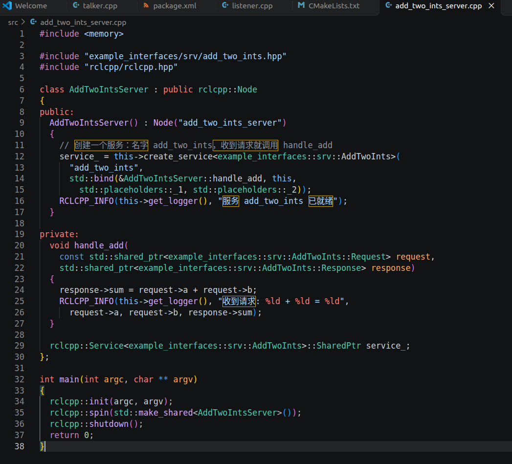

核心两段：

```cpp
// 创建服务：名字 "add_two_ints"，收到请求就调用 handle_add
service_ = this->create_service<example_interfaces::srv::AddTwoInts>(
  "add_two_ints",
  std::bind(&AddTwoIntsServer::handle_add, this,
    std::placeholders::_1, std::placeholders::_2));
```

```cpp
// 回调：请求里有两个数，把和写进响应
response->sum = request->a + request->b;
```

和服务相比，发布者是"往黑板上写、不管谁看"，服务端是"**有人问才答**"：请求（request）和响应（response）都是结构体，字段由服务类型定义。

### 3. CMake 里还要加规则（注意顺序）

```cmake
add_executable(add_two_ints_server src/add_two_ints_server.cpp)
ament_target_dependencies(add_two_ints_server rclcpp example_interfaces)
```

并把 `install` 那行的目标补上：

```cmake
install(TARGETS talker listener add_two_ints_server
  DESTINATION lib/${PROJECT_NAME})
```

**⚠️ 顺序有要求**：`add_executable` 必须在 `install(TARGETS ...)` **之前**，而且都要在 `ament_package()` **之前**。

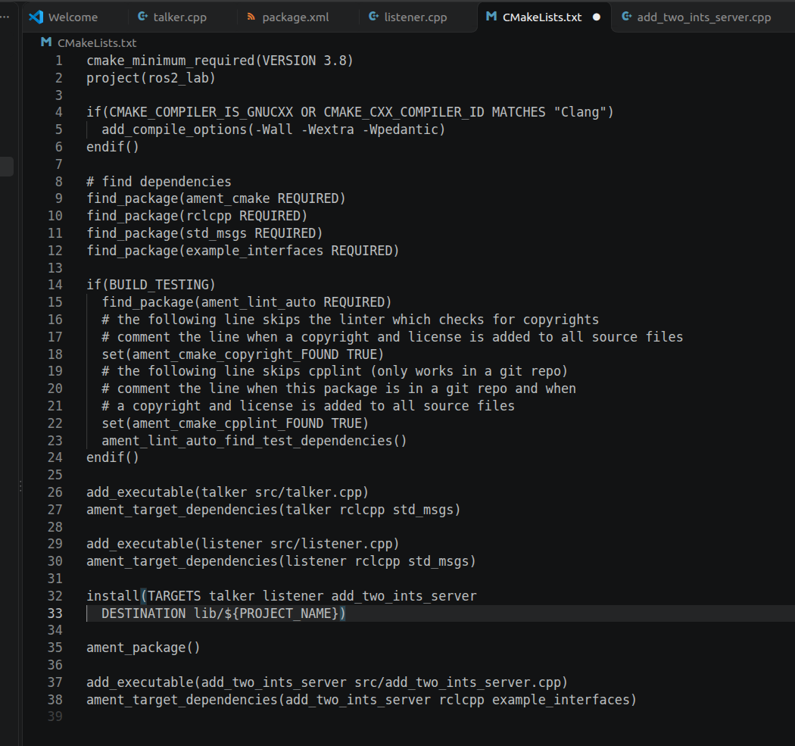

上面这张图里我就放错了位置：`install` 里已经列了 `add_two_ints_server`，可这个目标直到 `ament_package()` 之后才定义。CMake 是**按顺序执行**的，走到 `install` 那一行时目标还不存在，配置阶段就直接失败。真实的编译输出：

```
--- stderr: ros2_lab
CMake Error at CMakeLists.txt:32 (install):
  install TARGETS given target "add_two_ints_server" which does not exist.

gmake: *** [Makefile:308: cmake_check_build_system] Error 1
---
Failed   <<< ros2_lab [0.43s, exited with code 2]

Summary: 0 packages finished [0.61s]
  1 package failed: ros2_lab
  1 package had stderr output: ros2_lab
No executable found
```

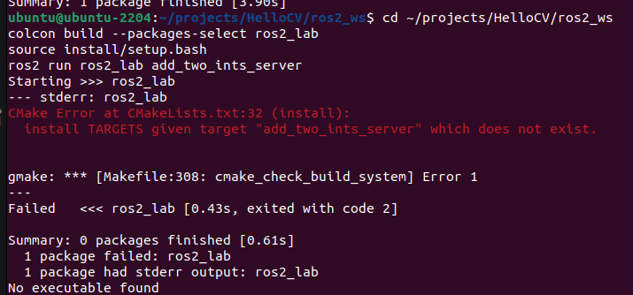

最后那行 `No executable found` 是紧接着执行 `ros2 run ros2_lab add_two_ints_server` 的结果——编译都没成功，自然没有可执行文件可跑。另外注意 `gmake` 那行：编译前 CMake 会先重新检查一遍配置（`cmake_check_build_system`），配置失败就直接停下，所以一次都没真正开始编译。

**改法**：把这两行挪到 `ament_package()` 之前、和另外两个 `add_executable` 放在一起。改好之后的顺序：

```cmake
add_executable(talker src/talker.cpp)
ament_target_dependencies(talker rclcpp std_msgs)

add_executable(listener src/listener.cpp)
ament_target_dependencies(listener rclcpp std_msgs)

add_executable(add_two_ints_server src/add_two_ints_server.cpp)
ament_target_dependencies(add_two_ints_server rclcpp example_interfaces)

install(TARGETS talker listener add_two_ints_server
  DESTINATION lib/${PROJECT_NAME})

ament_package()      # 永远在最后
```

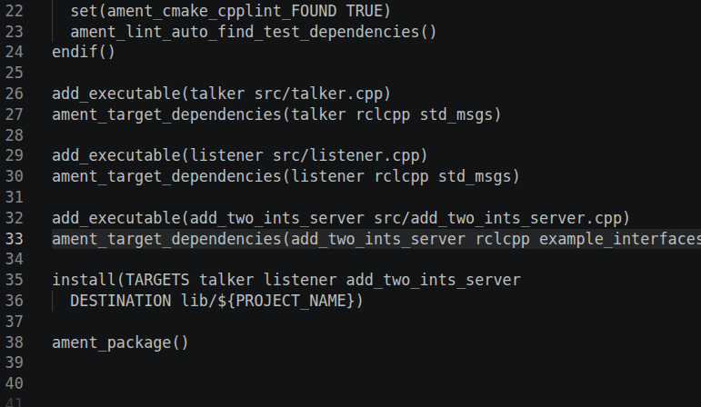

### 4. 编译与运行

```bash
cd ~/projects/HelloCV/ros2_ws
colcon build --packages-select ros2_lab
source install/setup.bash
ros2 run ros2_lab add_two_ints_server
```

真实输出：

```
Starting >>> ros2_lab
Finished <<< ros2_lab [3.29s]

Summary: 1 package finished [3.40s]
[INFO] [1792566109.970267236] [add_two_ints_server]: 服务 add_two_ints 已就绪
```

服务是"等别人来问"的：启动之后它就一直挂着，没有请求时不会打印任何东西。

### 5. 先用命令行验证，再写客户端

```bash
# 另一个终端（记得 cd + source）
ros2 service list
ros2 interface show example_interfaces/srv/AddTwoInts
ros2 service call /add_two_ints example_interfaces/srv/AddTwoInts "{a: 3, b: 4}"
```

`ros2 service list` 的真实输出：

```
/add_two_ints
/add_two_ints_server/describe_parameters
/add_two_ints_server/get_parameter_types
/add_two_ints_server/get_parameters
/add_two_ints_server/list_parameters
/add_two_ints_server/set_parameters
/add_two_ints_server/set_parameters_atomically
```

`ros2 interface show` 的真实输出（`---` 上面是请求、下面是响应）：

```
int64 a
int64 b
---
int64 sum
```

`ros2 service call` 的真实输出：

```
waiting for service to become available...
requester: making request: example_interfaces.srv.AddTwoInts_Request(a=3, b=4)

response:
example_interfaces.srv.AddTwoInts_Response(sum=7)
```

同一时刻服务端终端打印：

```
[INFO] [1792566167.128384611] [add_two_ints_server]: 收到请求: 3 + 4 = 7
```

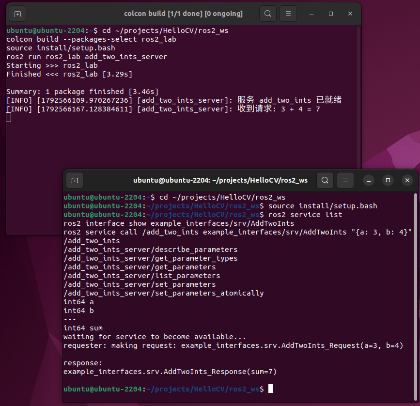

**我的理解**

那六个 `*/describe_parameters`、`*/get_parameters`、`*/set_parameters…` 不是我写的，是 **ROS 2 给每个节点自动挂上的**。参数系统本身就是用服务实现的：`ros2 param set` 背后其实是调了 `/<节点>/set_parameters` 这个服务。

这也是"服务"最典型的一个内置用例——想改一个正在运行的程序的行为，用请求-应答比用话题自然得多。

### 6. 再写客户端

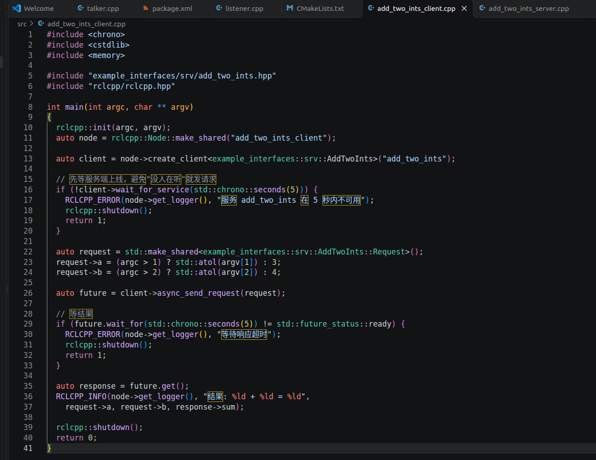

客户端比服务端多两步：**先等对方上线**（`wait_for_service`），再**发请求并等结果**（`async_send_request` + `future`）。

```cpp
auto client = node->create_client<example_interfaces::srv::AddTwoInts>("add_two_ints");
if (!client->wait_for_service(std::chrono::seconds(5))) { /* 服务没上线，直接退出 */ }

auto request = std::make_shared<example_interfaces::srv::AddTwoInts::Request>();
request->a = 3;  request->b = 4;

auto future = client->async_send_request(request);
```

第一次跑的时候，我在新开的终端里直接执行，忘了先 `cd` 和 `source`，于是又撞了一次同一个坑：

```
ubuntu@ubuntu-2204:~$ ros2 run ros2_lab add_two_ints_client 3 4
Package 'ros2_lab' not found
```

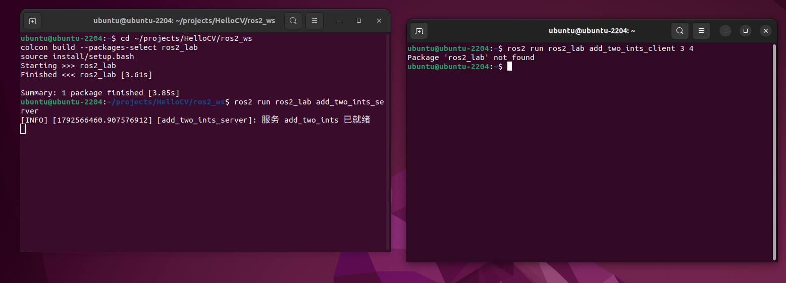

同一个错误犯第二次，说明"新终端先 `cd` + `source`"必须变成肌肉记忆。除了每次手敲，也可以在 `~/.bashrc` 里加一个别名：

```bash
alias rw='cd ~/projects/HelloCV/ros2_ws && source install/setup.bash'
```

以后新开终端敲 `rw` 就行。（注意：`alias` 只对**新开的**终端生效，已经开着的终端要先 `source ~/.bashrc`。）

关键改动只有一处——把"干等"换成"边转边等"：

```cpp
// 改之前：只等待，不处理回调 → 一定超时
if (future.wait_for(std::chrono::seconds(5)) != std::future_status::ready) { ... }

// 改之后：让节点转起来，响应才能被取回
auto ret = rclcpp::spin_until_future_complete(node, future, std::chrono::seconds(5));
if (ret != rclcpp::FutureReturnCode::SUCCESS) { ... }
```

### 7. 这个坑：服务端算出来了，客户端却说"等待响应超时"

按上面那份代码跑，两边是这样（真实输出）：

服务端（终端 A）：

```
[INFO] [1792566460.907576912] [add_two_ints_server]: 服务 add_two_ints 已就绪
[INFO] [1792566569.284570104] [add_two_ints_server]: 收到请求: 3 + 4 = 7
```

客户端（终端 B）：

```
[ERROR] [1792566574.288720101] [add_two_ints_client]: 等待响应超时
[ros2run]: Process exited with failure 1
```

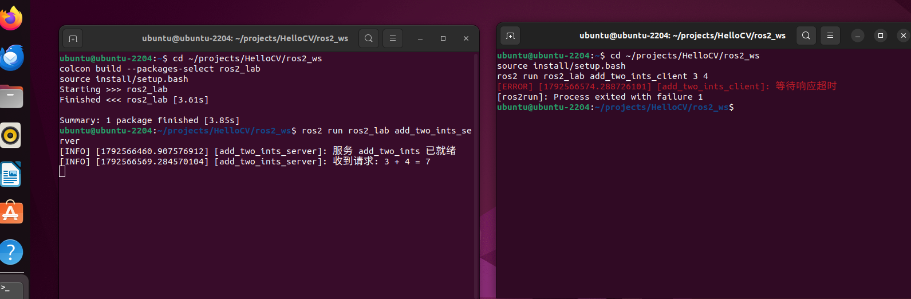

两个时间戳值得注意：服务端收到请求是 `…569.28`，客户端超时是 `…574.28`，**只差 5.000 秒**——正好是我写的 `future.wait_for(std::chrono::seconds(5))` 的 5 秒。也就是说客户端从头到尾都在"干等"，一直没等到值。

**定位过程**：三个问题把自己问明白了——

1. future 里的值是谁写的？→ 不是服务端（两个进程内存不通），是**客户端进程里的执行器**在处理"响应消息"时写进去的；
2. 服务端为什么能响应？→ 它的 `main` 里一直在 `rclcpp::spin(...)` 里转，事件来了就被处理；
3. 四个 `main` 摆一起，谁缺了同一句话？→ **客户端的 `main` 没有 spin**，注册的回调一次都没被执行。

我第一次的改法还写错了：`rclcpp::spin(std::make_shared<AddTwoIntsServer>())` ——`AddTwoIntsServer` 这个类只在服务端文件里，客户端编译直接失败：

```
gmake[2]: *** [CMakeFiles/add_two_ints_client.dir/src/add_two_ints_client.cpp.o] Error 1
gmake[1]: *** [CMakeFiles/add_two_ints_client.dir/all] Error 2
Failed   <<< ros2_lab [2.87s, exited with code 2]
```

改成 `rclcpp::spin_until_future_complete` 之后，编译和运行都正常了：

```cpp
// 把 future.wait_for(...) 换成"边转边等"
auto ret = rclcpp::spin_until_future_complete(node, future, std::chrono::seconds(5));
if (ret != rclcpp::FutureReturnCode::SUCCESS) {
  RCLCPP_ERROR(node->get_logger(), "等待响应失败或超时");
  rclcpp::shutdown();
  return 1;
}
```

真实输出：

服务端：
```
[INFO] [1792567358.815032967] [add_two_ints_server]: 服务 add_two_ints 已就绪
[INFO] [1792567380.011835520] [add_two_ints_server]: 收到请求: 3 + 4 = 7
```

客户端：
```
[INFO] [1792567380.012135705] [add_two_ints_client]: 结果: 3 + 4 = 7
```

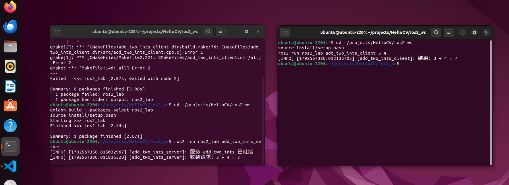

**一个对照**：如果只把 `wait_for` 换成 `rclcpp::spin(node)`，值也能填上，但 `spin` 是个死循环——它会一直等下一个事件，程序不退出。所以客户端要的是"**转到拿到结果就停**"，也就是 `spin_until_future_complete` 而不是 `spin`。

**我的理解**

future 里的值不是我写的，也不是服务端直接写的（两个进程内存不通）。链条是：服务端算完 → 把响应发回来 → **客户端进程收到这条"响应消息"** → rclcpp 的执行器处理它时，把结果填进 future。

`wait_for` 只是"看表"，它不会替你去处理消息，所以没有 spin 的时候，它永远等不到值，5 秒后超时。

客户端必须等服务，因为"发请求"的前提是"对面有人接"。`wait_for_service` 就是在问：这个服务名在图上出现了吗？没有就等，等不到就明确报错退出。

服务端不需要等谁：它是"提供方"，把服务注册上去、然后 spin 等请求就行——没有客户端的时候它安静挂着，不消耗什么。

## 二、参数服务器

### 1. 把写死的值改成参数

原来 `talker` 的周期写死成 `1s`、前缀写死成 `"hello "`。改成参数之后：

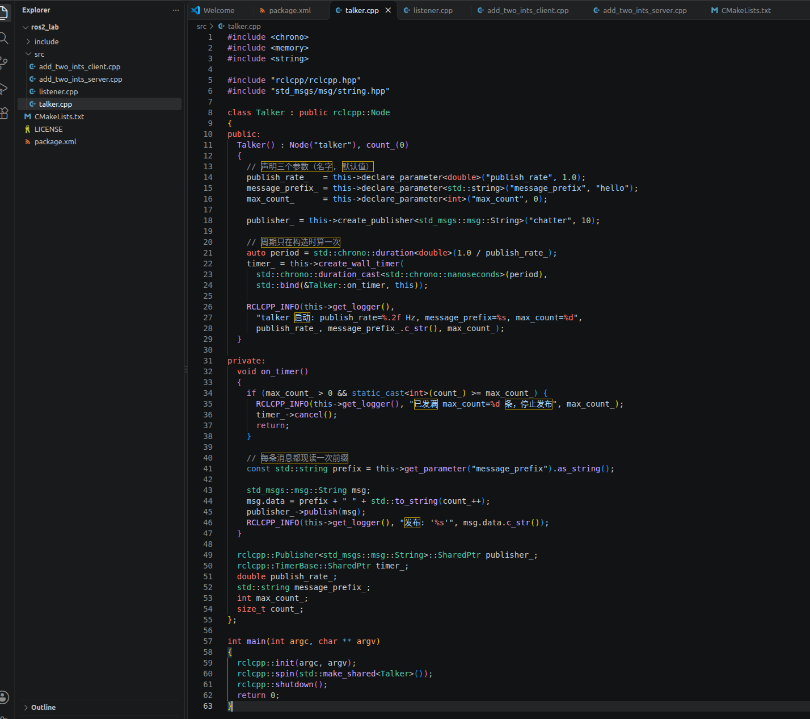

```cpp
// ① 声明参数（名字, 默认值）
publish_rate_   = this->declare_parameter<double>("publish_rate", 1.0);
message_prefix_ = this->declare_parameter<std::string>("message_prefix", "hello");
max_count_      = this->declare_parameter<int>("max_count", 0);

// ② 周期只在构造时算一次
auto period = std::chrono::duration<double>(1.0 / publish_rate_);

// ③ 前缀每条消息现读一次
const std::string prefix = this->get_parameter("message_prefix").as_string();
```

### 2. 用命令行查看和修改（真实输出）

```bash
ros2 param list /talker
ros2 param get /talker publish_rate
ros2 param get /talker message_prefix
ros2 param set /talker message_prefix changed
ros2 param set /talker publish_rate 2.0
```

```
max_count
message_prefix
publish_rate
qos_overrides./parameter_events.publisher.depth
qos_overrides./parameter_events.publisher.durability
qos_overrides./parameter_events.publisher.history
qos_overrides./parameter_events.publisher.reliability
use_sim_time
Double value is: 1.0
String value is: hello
Set parameter successful
Set parameter successful
```

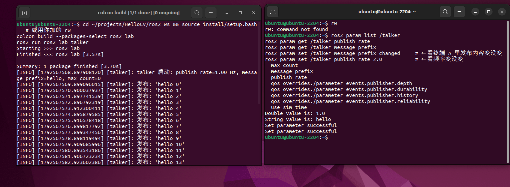

前三个是我在代码里声明的，后面五个（`qos_overrides.*`、`use_sim_time`）是 ROS 2 自动带的。

### 3. 关键差异：两个 `set` 都成功了，但只有一个真的改变了行为

- `set publish_rate 2.0` 返回 `Set parameter successful`，**但发布频率没变**——时间戳还是每秒一条（`…569.9`、`…570.9`、`…571.9`……）。因为定时器的周期是**构造时算好的**，参数再变也不会重建定时器。
- `set message_prefix changed` 之后，**后续消息的前缀真的变了**——`on_timer()` 里每条消息都现读一次 `get_parameter("message_prefix")`，所以立刻生效：

```
[INFO] [1792567681.895568661] [talker]: 发布: 'changed 111'
[INFO] [1792567683.200607493] [talker]: 发布: 'changed 112'
[INFO] [1792567683.874787066] [talker]: 发布: 'changed 113'
...
[INFO] [1792567702.916519286] [talker]: 发布: 'changed 132'
```

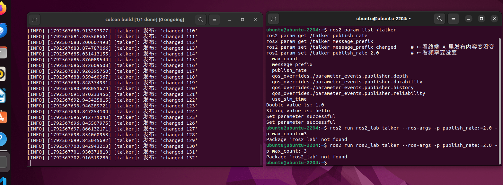

**规律**：参数"能不能热更新"不取决于 `param set`，而取决于**代码什么时候读这个参数**——构造时读进成员变量，就只影响启动；每次使用时现读，就能立刻生效；想改"结构性的东西"（比如定时器周期），得注册参数回调重新创建资源。

**我的理解**

区别在**代码什么时候读这个参数**：

- `message_prefix` 是每条消息都 `get_parameter(...)` 现读，所以 `set` 完下一条就变了；
- `publish_rate` 在构造时就被换算成周期交给定时器，之后再也没人读它——参数值变了，但没人去重建定时器。

想让频率也热改，得注册参数回调：在 `add_on_set_parameters_callback` 里检测到 `publish_rate` 变化时，把旧定时器 `cancel()` 掉、按新周期重建一个。

### 4. 启动时传参（不改代码）

```bash
ros2 run ros2_lab talker --ros-args -p publish_rate:=2.0 -p max_count:=3
```

真实输出：

```
[INFO] [1792567787.302767676] [talker]: talker 启动: publish_rate=2.00 Hz, message_prefix=hello, max_count=3
[INFO] [1792567787.803073063] [talker]: 发布: 'hello 0'
[INFO] [1792567788.304578872] [talker]: 发布: 'hello 1'
[INFO] [1792567788.802826084] [talker]: 发布: 'hello 2'
[INFO] [1792567789.302922291] [talker]: 已发满 max_count=3 条，停止发布
```

启动日志里的 `publish_rate=2.00` 和 `max_count=3` 都是命令行给的值，不是代码默认值（默认是 1.0 和 0）。时间戳间隔也从 1 秒变成了 0.5 秒。

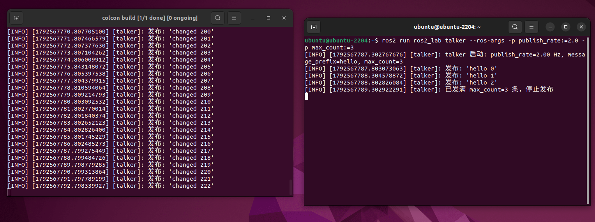

**我的理解**

启动传参（`--ros-args -p`）适合**可复现的一次性配置**：比如"这次跑 2Hz、发 3 条就停"，写在命令里，别人复制就能复现。

运行中 `param set` 适合**边跑边调**：看效果、临时改，不用重启。缺点是改的是运行中的实例，重启就回到默认值。

## 三、TF 与 RViz

### 1. 广播一个坐标变换

TF 要回答的是"**同一个点在不同坐标系里坐标不一样**"这件事。这次广播的是"激光雷达相对车体在哪、朝向如何"：

```cpp
// 父坐标系 → 子坐标系
t.header.frame_id = "base_link";
t.child_frame_id  = child_frame_;      // 默认 "laser"

// 雷达装在车体前方 20cm、高 10cm
t.transform.translation.x = 0.20;
t.transform.translation.z = 0.10;

// 每 100ms 绕 z 轴转一点，让 rviz 里能看出它在动
yaw_ += rate_deg_ * 0.1 * kPi / 180.0;
```

编译与启动的真实输出：

```
Starting >>> ros2_lab
Finished <<< ros2_lab [13.7s]

Summary: 1 package finished [14.2s]
[INFO] [1792645937.075772758] [tf_broadcaster]: tf 广播启动: base_link -> laser, rate_deg=45.0
```

### 2. 用 `tf2_echo` 验证这条变换真的在发

```bash
ros2 run tf2_ros tf2_echo base_link laser
```

真实输出（第一行是刚启动那一瞬间的等待信息，属正常现象）：

```
[INFO] [1792645941.257346949] [tf2_echo]: Waiting for transform base_link ->  laser: Invalid frame ID "base_link" passed to canTransform argument target_frame - frame does not exist
At time 1792645941.973734426
- Translation: [0.200, 0.000, 0.100]
- Rotation: in Quaternion (xyzw) [0.000, 0.000, 0.938, -0.346]
- Rotation: in RPY (radian) [0.000, -0.000, -2.435]
- Rotation: in RPY (degree) [0.000, -0.000, -139.500]
- Matrix:
 -0.760  0.649  0.000  0.200
 -0.649 -0.760  0.000  0.000
  0.000  0.000  1.000  0.100
  0.000  0.000  0.000  1.000
```

平移 `[0.200, 0.000, 0.100]` 和代码里写的 `0.20 / 0 / 0.10` 完全对上；旋转值每个周期都在变，说明广播是持续在发的。

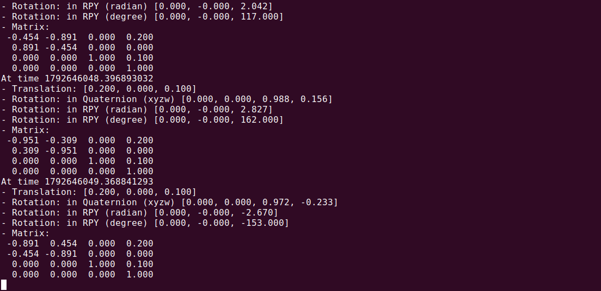

### 3. 生成 TF 树

```bash
ros2 run tf2_tools view_frames
```

真实输出：

```
[INFO] [1792645946.165718516] [view_frames]: Listening to tf data for 5.0 seconds...
[INFO] [1792645951.174038926] [view_frames]: Generating graph in frames.pdf file...
[INFO] [1792645951.182645920] [view_frames]: Result:tf2_msgs.srv.FrameGraph_Response(frame_yaml="laser: \n  parent: 'base_link'\n  broadcaster: 'default_authority'\n  rate: 10.210\n  most_recent_transform: 1792645951.169208\n  oldest_transform: 1792645946.173904\n  buffer_length: 4.995\n")
```

那串 `frame_yaml` 就是树的结构：**`laser` 的父节点是 `base_link`**，实测频率 10.21 Hz。它同时在当前目录生成两份文件：

```
frames_2026-10-22_13.12.31.gv     ← 图的结构（文本）
frames_2026-10-22_13.12.31.pdf    ← 画好的图
```

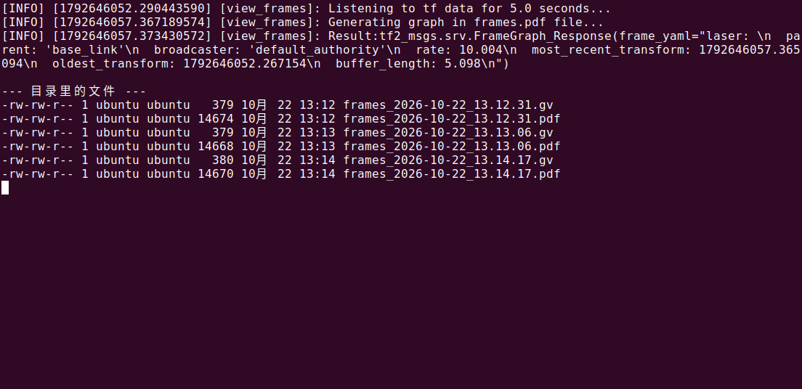

把 `.gv` 转成图片方便贴进笔记：

```bash
dot -Tpng frames_2026-10-22_13.12.31.gv -o tf_tree.png
```

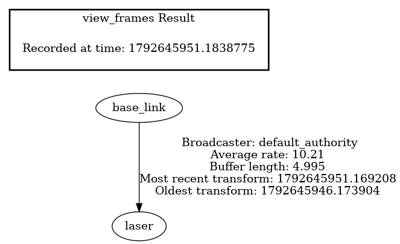

### 4. 在 RViz 里看 TF

在虚拟机桌面里启动：

```bash
rviz2
```

三步设置：**Global Options → Fixed Frame 改成 `base_link`**；**左下 Add → 选 `TF` → OK**；Grid 保持勾选。

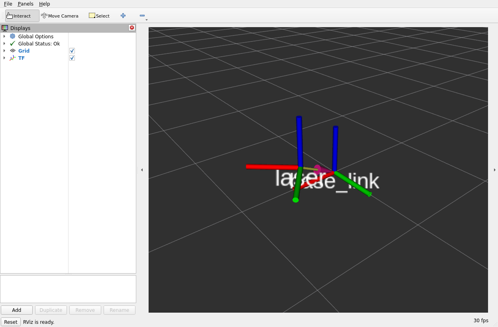

### 5. 对照：没有广播者的时候，TF 树是空的

编译失败、`tf_broadcaster` 没跑起来时，另外两条命令的表现是这样的：

```
[INFO] [1792645786.415589759] [tf2_echo]: Waiting for transform base_link ->  laser: Invalid frame ID "base_link" passed to canTransform argument target_frame - frame does not exist
```

```
[INFO] [1792645796.129466825] [view_frames]: Result:tf2_msgs.srv.FrameGraph_Response(frame_yaml='[]')
```

`frame_yaml='[]'` 就是"一棵空的树"——`view_frames` 只统计它在这 5 秒里**听到**的变换，没人广播自然什么都没有。这也是排查 TF 问题的第一步：先确认有没有人在发。

**我的理解**

`Translation: [0.200, 0.000, 0.100]` 对应的是三行赋值：`translation.x = 0.20`、`translation.y = 0.0`、`translation.z = 0.10`，单位是米——正好是"雷达装在车体前方 20cm、高 10cm"。

旋转一直在变，是因为回调里每个周期都在累加 `yaw_ += rate_deg_ * 0.1 * ...`，再把 `yaw_` 转成四元数发出去；`rate_deg=45` 表示每秒转 45 度。

TF 树里每个坐标系只能有**一个父**：从 `base_link` 往上追必须能追到同一个根，任意两个坐标系之间的变换才是唯一确定的。如果一个坐标系有两个父，同一时刻它就等于有两个位置，别人算出来的结果取决于"听谁的"。

如果两个节点同时广播 `base_link → laser`，会互相覆盖：后到的变换把前一个顶掉，接收方看到的位置就会来回跳。规范做法是**一个变换只由一个节点负责**。

## 四、launch 文件

### 1. 结构

```python
from launch import LaunchDescription
from launch.actions import DeclareLaunchArgument
from launch.substitutions import LaunchConfiguration
from launch_ros.actions import Node
from launch_ros.parameter_descriptions import ParameterValue

def generate_launch_description():
    prefix = LaunchConfiguration('prefix')
    rate = LaunchConfiguration('rate')

    return LaunchDescription([
        DeclareLaunchArgument('prefix', default_value='launch', description='消息前缀'),
        DeclareLaunchArgument('rate', default_value='2.0', description='发布频率 Hz'),

        Node(package='ros2_lab', executable='talker', name='talker', output='screen',
             parameters=[{'publish_rate': ParameterValue(rate, value_type=float),
                          'message_prefix': ParameterValue(prefix, value_type=str)}],
             remappings=[('chatter', 'demo/chatter')]),

        Node(package='ros2_lab', executable='listener', name='listener', output='screen',
             remappings=[('chatter', 'demo/chatter')]),

        Node(package='ros2_lab', executable='tf_broadcaster', name='tf_broadcaster',
             output='screen', parameters=[{'rate_deg': 30.0}]),
    ])
```

`DeclareLaunchArgument` 是"可以在命令行覆盖的参数"，`Node` 里三样东西最常用：`executable`（跑哪个可执行文件）、`parameters`（启动时传参）、`remappings`（改话题名）。

还要在 `CMakeLists.txt` 里把这个目录装进 `share/`，否则 `ros2 launch` 找不到它：

```cmake
install(DIRECTORY launch
  DESTINATION share/${PROJECT_NAME})
```

### 2. 先看它支持哪些参数

```bash
ros2 launch ros2_lab demo.launch.py --show-args
```

```
Arguments (pass arguments as '<name>:=<value>'):

    'prefix':
        消息前缀
        (default: 'launch')

    'rate':
        发布频率 Hz
        (default: '2.0')
```

### 3. 一次启动三个节点（真实输出）

```bash
ros2 launch ros2_lab demo.launch.py
```

```
[INFO] [launch]: All log files can be found below /home/ubuntu/.ros/log/2026-10-22-13-16-10-084045-ubuntu-2204-35401
[INFO] [launch]: Default logging verbosity is set to INFO
[INFO] [talker-1]: process started with pid [35413]
[INFO] [listener-2]: process started with pid [35415]
[INFO] [tf_broadcaster-3]: process started with pid [35417]
[tf_broadcaster-3] [INFO] [1792646171.090854513] [tf_broadcaster]: tf 广播启动: base_link -> laser, rate_deg=30.0
[talker-1] [INFO] [1792646171.245642995] [talker]: talker 启动: publish_rate=2.00 Hz, message_prefix=launch, max_count=0
[talker-1] [INFO] [1792646171.767061083] [talker]: 发布: 'launch 0'
[listener-2] [INFO] [1792646171.767875609] [listener]: 收到: 'launch 0'
[talker-1] [INFO] [1792646172.259296720] [talker]: 发布: 'launch 1'
[listener-2] [INFO] [1792646172.260525833] [listener]: 收到: 'launch 1'
```

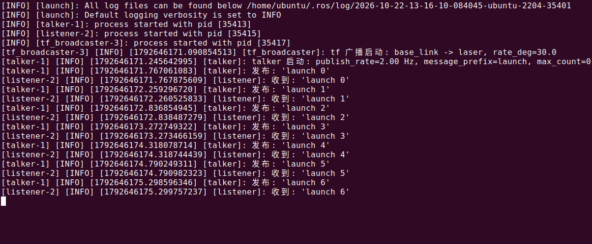

三处值都不是代码默认值，而是 launch 给的：`publish_rate=2.00`（来自 `rate`）、`message_prefix=launch`（来自 `prefix`）、`rate_deg=30.0`。

### 4. 验证话题 remap 生效

```bash
ros2 topic list
ros2 param get /talker publish_rate
ros2 topic info /demo/chatter
```

```
/demo/chatter
/parameter_events
/rosout
/tf

Double value is: 2.0

Type: std_msgs/msg/String
Publisher count: 1
Subscription count: 1
```

原来叫 `/chatter` 的话题被 remap 成了 `/demo/chatter`，而且发布端和订阅端**都**改了，所以还能对上——只改一边的话，两边谁也收不到。

**我的理解**

最直接的是省了"开三个终端、每个都 cd + source + 敲命令"；更重要的是把**参数和话题名收敛到一处**——改频率改 launch 文件就行，不用挨个改命令；remap 写一次，起的所有节点都用同一套话题名。

remap 只改一边的后果很干脆：两边话题名不同，谁也收不到谁，`topic info` 里会显示 0 个订阅者。我第一次就没把 listener 也 remap，现象就是这样。

`DeclareLaunchArgument` 声明"这个 launch 文件接受一个可以在命令行覆盖的参数"，并给默认值；文件里用 `LaunchConfiguration('rate')` 取到它。

`ParameterValue(rate, value_type=float)` 是把"命令行传进来的字符串"转成**指定类型的参数值**。不写它的话，传进去的就是字符串，节点那边 `declare_parameter<double>` 会因为类型对不上而报错。

## 五、问题与排查记录

### 1. `install` 在 `add_executable` 之前，配置阶段就失败

**现象**：`colcon build` 在配置阶段就失败，编译一次都没真正开始：

```
--- stderr: ros2_lab
CMake Error at CMakeLists.txt:32 (install):
  install TARGETS given target "add_two_ints_server" which does not exist.

gmake: *** [Makefile:308: cmake_check_build_system] Error 1
---
Failed   <<< ros2_lab [0.43s, exited with code 2]
```

紧接着 `ros2 run ros2_lab add_two_ints_server` 又报 `No executable found`——因为压根没编译出东西。

**原因**：CMake 按顺序执行；`install(TARGETS ...)` 会当场检查目标是否存在，而 `add_executable` 被写在了后面（甚至写到了 `ament_package()` 之后）。

**修改**：把 `add_executable` / `ament_target_dependencies` 挪到 `ament_package()` 之前。

**验证**：重新 `colcon build`，配置通过。

**理解**：`ament_package()` 是这个包的"收尾"，写在它后面的语句等于游离在包定义之外；而 `install` 只关心"此刻这个名字有没有被定义过"。

### 3. 问题汇总表

| # | 现象 | 原因分析 | 解决办法 | 验证结果 |
| --- | --- | --- | --- | --- |
| 1 | `CMake Error ... install TARGETS given target ... does not exist` | `install` 写在 `add_executable` 之前 | 把目标定义挪到 `ament_package()` 之前 | 编译通过 |
| 2 | 客户端编译报 `add_two_ints_client.cpp.o] Error 1` | 写了 `rclcpp::spin(std::make_shared<AddTwoIntsServer>())`，而客户端里没有 `AddTwoIntsServer` 这个类 | 改用 `rclcpp::spin_until_future_complete(node, future, 5s)` | 编译通过、拿到 3+4=7 |
| 3 | 客户端 `等待响应超时`，服务端却打印了"收到请求" | 客户端没有 spin，响应没人从 DDS 里取回 | 同上（边转边等） | 同一毫秒打印结果 |
| 4 | 加 `tf_broadcaster` 时把 client 的 `add_executable` 覆盖掉了，`install` 里仍引用它 → `install TARGETS given target "add_two_ints_client" which does not exist` | 新增目标时误删了旧目标；`install` 的名单和实际定义的名单不一致 | 补回 client 的两行 `add_executable`/`ament_target_dependencies`，并把 `tf_broadcaster` 也加进 `install` | 编译通过 |
| 5 | `tf2_echo` 报 `Invalid frame ID "base_link"`、`view_frames` 输出 `frame_yaml='[]'` | 广播节点根本没跑起来（编译失败），TF 树是空的 | 先修编译、再确认 `tf_broadcaster` 在跑 | 出现 `laser: parent: 'base_link'` |
| 6 |  |  |  |  |

## 六、测试与验证

| 测试项 | 方法 | 预期结果 | 实际结果 | 结论 |
| --- | --- | --- | --- | --- |
| 服务端启动 | `ros2 run ros2_lab add_two_ints_server` | 打印"服务已就绪" |  |  |
| 命令行调用 | `ros2 service call ... "{a: 3, b: 4}"` | 返回 sum: 7 |  |  |
| 客户端调用 | `ros2 run ros2_lab add_two_ints_client 3 4` | 打印 3 + 4 = 7 |  |  |

## 七、回顾与心得

- **服务和话题的本质区别**：话题是"广播、不保证有人听"，服务是"请求-应答、必须有人接"；参数系统本身也是用服务实现的。
- **依赖要改两个文件**：`package.xml` 给 ROS 生态，`find_package` 给编译器。
- **CMake 的顺序约束**：`find_package` 先于使用，`add_executable` 先于 `install`，`ament_package()` 收尾。
- 还有一条不是知识、是习惯的：**新终端先 source**——我在这个坑里摔了三次。

## 参考资料

- [R1] ROS 2 Documentation — Humble：Services、Parameters、tf2、launch
- [R2] 动手学 ROS 2：服务与参数入门
- [T1] `example_interfaces/srv/AddTwoInts` 接口定义
